[English](README.md) | [Deutsch](README_de.md)

# ujc-security-checker

A review station for external tools - GitHub repositories, Claude Code plugins, skills, MCP
servers, CLI tools, Python and npm packages. It helps you decide whether a tool may go onto your
developer machines and, if it is worth it but not safe as it is, adopt it as a private, hardened
fork, fix it, test it and set it up.

Review scenario: a developer machine (Windows 11) with Claude Code and Codex CLI, guard hooks,
binding global rules and several parallel sessions per repository.

License: MIT ([`LICENSE`](LICENSE)). Security reports about this repository: [`SECURITY.md`](SECURITY.md).

> **New here?** [Getting started](docs/GETTING-STARTED.md) explains, without assuming anything, what this is, why it is needed today, which tools run for what, how new and already installed tools are reviewed, and how it fits with [claudex-loop](https://github.com/ujconsulting/claudex-loop). Deutsch: [Einstieg](docs/GETTING-STARTED_de.md).

## What it does

- **Review workflow** - one documented process from intake to maintenance, with abort criteria
  per step; audits and review rounds stay local under `private/records/<name>/`, and a short public
  summary per reviewed tool is published under [`repos/`](repos/) (skill
  [`tool-review`](.claude/skills/tool-review/README.md)).
- **Quarantine and supply chain** - clones on a fixed tag, never executed; the published package
  is compared with the tag, bundles with the source.
- **Scanners** - all static scanners (secrets, SAST, GitHub Actions, Dockerfiles, metrics, SBOM,
  vulnerability databases) run in one pinned scanner image, not on the host
  ([`tools/scan.sh`](tools/README.md), [`tools/scanner-image/`](tools/scanner-image/README.md)).
- **Sandbox with egress control** - containers never get the default bridge network; installation
  only in an internal Docker network behind a Squid proxy with an allowlist (LAN blocked), then
  the network is disconnected and the disconnection is verified; every blocked attempt is a
  finding ([`tools/egress/`](tools/egress/README.md), skills
  [`sandbox-setup`](.claude/skills/sandbox-setup/README.md) and
  [`docker-sandbox`](.claude/skills/docker-sandbox/README.md)).
- **Codex and CodeRabbit reviews** - the same audit brief goes to a Claude sub-agent and to Codex
  (read-only via `tools/codex_ro.py` from [claudex-loop](https://github.com/ujconsulting/claudex-loop));
  optionally a CodeRabbit full review of public repositories (`tools/cr_full_review.sh`).
- **Behavior probe** - after approval, the entry point of a tool runs once in the sandbox under
  strace, tcpdump and inotify: started programs, connection targets, written files
  (`tools/behavior_probe.sh`).
- **Hardened forks** - if a tool is worth it, a private fork with patch rounds, a threat model and a
  final test per round. The fork and everything about it stay private; the public summary here
  covers only the upstream tool.
- **Disclosure with policy check** - findings go upstream only through tools with a mandatory check
  against the upstream security policy, a leak scan and a hash-bound one-time approval
  (skill [`finding-disclosure`](.claude/skills/finding-disclosure/README.md),
  [`tools/disclosures/`](tools/disclosures/README.md)).
- **Watch of reports, inbox and own repository** - a read-only watch follows the disclosures
  (comments, linked PRs, advisories, mailbox), new upstream issues/PRs and the inbox of this
  repository ([`disclosures/`](disclosures/README.md)).
- **Public/private gate** - `tools/public_check.py` keeps internal details, AI attribution,
  German text outside `*_de.md` and embargoed findings out of every commit and push; `repos/` may
  hold only the summaries (`README.md`, `README_de.md`).

## Quick start

Prerequisites: Python 3.10+, git, bash 4.4+ (Git Bash on Windows; macOS: `brew install bash`), Docker 28+ with Linux
containers, **ShellCheck 0.11+** (`tools/setup.sh` stops without it), GitHub CLI `gh`. Details and
checks: [`docs/SETUP.md`](docs/SETUP.md#1-prerequisites).

```bash
git clone https://github.com/ujconsulting/ujc-security-checker.git
cd ujc-security-checker
git config core.autocrlf false                   # files are LF
python tools/public_check.py --self-test          # Python 3.10+, standard library only
shellcheck --version                              # required, see prerequisites
tools/setup.sh --check                            # sandbox status (Docker); exit 0 = ready, exit 1 before the first setup
tools/setup.sh                                    # set up egress network, proxy, scanner image
python tools/codex_skills_sync.py --check         # skills mirrored for Codex
```

Complete installation in order, each step with its expected result:
[`docs/SETUP.md`](docs/SETUP.md). Skill overview: [`docs/SKILLS.md`](docs/SKILLS.md).

## The process on one page



**You come in at three places:** the decision after the audit (do not use / use as it is /
harden a fork), the approval before anything from the reviewed repository runs in a container,
and the hash-bound approval of every disclosure text. Everything before the decision only reads:
the clone is never executed, scanners and reviewers work read-only.

**Orange is who acts on the tool, green is who checks it.** The colors name *roles*, not
products: the initial audit and the final test are run by Claude and Codex alike; the checking
steps produce findings, the acting steps produce clones, patches and drafts. Grey is the record:
the review rounds are written locally under `private/records/<name>/reviews/`, and the public
result is the summary `repos/<name>/README.md`.

**Dotted edges are conditional.** Any step can end the review once its abort criterion in the
table below is met; the reason goes into the record and the summary. Disclosures leave the machine only on
instruction, and an upstream update starts a new patch round. Solid edges always happen.

| # | Step | Result | Abort if ... |
|---|---|---|---|
| 1 | **Intake**: repository, purpose, intended use | local record `private/records/<name>/` | use unclear |
| 2 | **Quarantine clone** on a fixed tag, structure: what actually runs | full SHA, list of hooks/MCP/entry points/bundles | no reproducible state |
| 3 | **Supply chain**: published package against the tag, bundles against the source | "identical except ..." | the package contains code that is missing in the tag |
| 4 | **Scanners** in the scanner image (`tools/scan.sh`): secrets, SAST, Actions, Dockerfiles, metrics, SBOM offline; vulnerability DBs via the egress proxy | `scan-summary.md` -> short version in the local record | - |
| 5 | **Initial audit**: the same audit brief to a Claude sub-agent and Codex, findings verified by ourselves; optionally a CodeRabbit full review (`tools/cr_full_review.sh`, public repositories only, announce the quota) and further second opinions | local `private/records/<name>/reviews/round-01/02-...` with `VERDICT:` | - |
| 6 | **Upstream research**: fixed, intended, useful PRs | local `private/records/<name>/reviews/round-NN-upstream-research.md` | - |
| 7 | **Usage analysis**: where it helps, where not | private, not in this repository | - |
| 8 | **Decision** of the owner: do not use / use as it is / harden a fork - with a threat model | scope of use, standard | "do not use" |
| 9 | **Fork** (private), patch rounds: close classes, disable what is not needed | one commit per round, `UJC-PATCHES.md`; documented only under `private/repos/<name>/` | scope grows beyond what can be maintained |
| 10 | **Final test** per round (Codex `gpt-6-astra`/medium), previous findings first | `FINAL TEST: ...`, disposition | the same finding class twice -> clarify the standard |
| 11 | **Container tests** after approval, with an upstream comparison; **behavior probe** (`tools/behavior_probe.sh`) after approval per tool - both only in the egress network, network disconnected afterwards | local `reviews/round-NN-container-test.md`, `...-behavior-probe.md` under `private/records/<name>/` | blocked egress attempts without explanation |
| 12 | **Release**: push to the private repository, installation, `docs/ujc/UJC-USAGE.md` in the fork | use in private notes; public result: the summary `repos/<name>/README.md` (written from `templates/repo-README.md`) | - |
| 13 | **Maintenance**: fork watch, update = re-apply patches + final test | new rounds | - |
| 14 | **Disclosures to upstream** only on instruction | draft first | - |

Full text with commands, lessons and pitfalls: skill [`tool-review`](.claude/skills/tool-review/SKILL.md).
Rules for agents: [`CLAUDE.md`](CLAUDE.md) (Claude Code) and [`AGENTS.md`](AGENTS.md) (Codex reviewer
role); templates: [`templates/`](templates/); tools: [`tools/README.md`](tools/README.md).

## How each part works

The diagram above shows the whole process; the following diagrams show one part each. The colors
are the same: orange acts, green checks, yellow is a human decision, grey is the record, red stops.

### Quarantine clone and supply chain

The tool is cloned on a fixed tag and never executed. What users really install is the published
package, so it is compared with the tag, and bundles are compared with the source.



### Scanners

All static scanners run in the pinned scanner image: first offline, then only for the database
downloads through the egress proxy (list `scanner`), then the summary (`tools/scan.sh`).



### Sandbox with egress control

Foreign code runs only after an approval that names the full commit SHA, only in the internal
network behind the proxy, and without any network after the installation. Every blocked attempt is
a finding.



### Hardened fork

A private fork is patched in rounds, each round is checked by a reviewer who did not write it, and
every upstream update starts the cycle again. The fork itself stays private.



### Disclosure

A finding goes upstream only through a fixed chain, with a hash-bound, one-time approval of exactly
that text.



### Watch of reports, inbox and own repository

The watch is read-only. Comments are claims: "fixed" is set in the register only after a human has
read the merged code.



### Public/private gate

Before every commit and push, `tools/public_check.py` keeps internal details, AI attribution,
German text outside `*_de.md` and embargoed findings out of the public repository.



## Safety rules

- **Nothing from a reviewed repository is installed or executed** before the owner explicitly
  approves it - no `pip`/`npm install`, build, test, import or script. Tests run only in the
  isolated container, and that container gets network only via the egress proxy (allowlist, LAN
  blocked), afterwards none at all.
- **Nothing leaves the machine without approval**: no push, no issue, comment, advisory or mail
  without an explicit instruction; disclosures need a hash-bound approval of exactly that text.
- **Embargo**: material on critical findings stays in the gitignored `private/` folder until
  upstream has published a fix or an advisory.
- **Public repository**: no local paths, LAN addresses, internal host names, names of non-public
  own projects or customers in versioned files; `tools/public_check.py` enforces it before every
  commit and push (git hooks in `.githooks/`).
- **Comments are claims**: "fixed" is set only by a human after reading the merged code.

## Skills (`.claude/skills/`)

| Skill | for |
|---|---|
| [`tool-review`](.claude/skills/tool-review/README.md) | the whole process from intake to maintenance |
| [`usage-analysis`](.claude/skills/usage-analysis/README.md) | where the tool helps in your projects and where not (result is private) |
| [`finding-disclosure`](.claude/skills/finding-disclosure/README.md) | report findings upstream, track answers and fixes, inbox of the own repository and mailbox |
| [`mcp-build`](.claude/skills/mcp-build/README.md) | build own MCP servers, adopt third-party ones - house rules |
| [`sandbox-setup`](.claude/skills/sandbox-setup/README.md) | set up, check, tear down egress network, proxy, scanner image (`tools/setup.sh`) |
| [`docker-sandbox`](.claude/skills/docker-sandbox/README.md) | throwaway containers for installation, tests and behavior probe (only via the egress proxy) |
| [`proxmox-lxc-sandbox`](.claude/skills/proxmox-lxc-sandbox/README.md) | throwaway LXC on Proxmox when Docker is not enough |

The agents load `SKILL.md`; `README.md` / `README_de.md` next to it are short docs for humans.
Codex CLI finds the skills under `.agents/skills/` (generated by
`python tools/codex_skills_sync.py`), see [`AGENTS.md`](AGENTS.md). Overview: [`docs/SKILLS.md`](docs/SKILLS.md).

## Index of reviewed repositories

| Repository | Upstream @ pinned version | Reviewed | Verdict | Recommendation |
|---|---|---|---|---|
| [agents-office](repos/agents-office/README.md) | `ajsahni/agents-office` @ `v3.2.1-beta.2` | 12.10.2026 | `DO NOT USE` | do not use |
| [graphify](repos/graphify/README.md) | `Graphify-Labs/graphify` @ `v0.9.76` | 04.10.2026 | `USABLE WITH CONDITIONS` (Codex) | only with conditions |
| [oh-my-claudecode](repos/oh-my-claudecode/README.md) | `Yeachan-Heo/oh-my-claudecode` @ `v5.6.1` | 04.10.2026 | `DO NOT USE` (Codex) | do not use |
| [paperclip](repos/paperclip/README.md) | `paperclipai/paperclip` @ `v2026.1005.0` | 12.10.2026 | `DO NOT USE` (Claude + Codex) | do not use |
| [herald-os](repos/herald-os/README.md) | `iamlukethedev/Herald-OS` @ `v0.1.0-alpha.3` | 12.10.2026 | `DO NOT USE` (Claude) | do not use |
| [context-mode](repos/context-mode/README.md) | `mksglu/context-mode` @ `v1.0.169` | 21.10.2026 | `DO NOT USE` (Claude + Codex) | do not use |
| [rustdesk](repos/rustdesk/README.md) | `rustdesk/rustdesk` @ `1.5.0` | 31.10.2026 | `USABLE WITH CONDITIONS` (Claude; Codex pending) | only with conditions |
| [rustdesk-server](repos/rustdesk-server/README.md) | `rustdesk/rustdesk-server` @ `1.1.16` | 31.10.2026 | `USABLE WITH CONDITIONS` (Claude; Codex pending) | only with conditions |
| [handy](repos/handy/README.md) | `cjpais/Handy` @ `v0.9.8` | 31.10.2026 | `USABLE WITH CONDITIONS` (Claude + Codex) | only with conditions |
| [voicestudio](repos/voicestudio/README.md) | `debpalash/VoiceStudio` @ `v0.5.7` | 31.10.2026 | `USABLE WITH CONDITIONS` (Claude + Codex) | only with conditions |
| [mirofish](repos/mirofish/README.md) | `666ghj/MiroFish` @ `v0.1.2` | 31.10.2026 | `DO NOT USE` (Claude + Codex) | do not use |
| [linkedin-skills](repos/linkedin-skills/README.md) | `sergebulaev/linkedin-skills` @ `v1.1.28` | 31.10.2026 | `USABLE WITH CONDITIONS` (Claude; Codex round open) | only with conditions |
| [openwhispr](repos/openwhispr/README.md) | `OpenWhispr/openwhispr` @ `v1.11.0` | 31.10.2026 | `USABLE WITH CONDITIONS` (Claude; Codex round open) | only with conditions |

The assessments are static reviews of exactly the named version and no guarantee. They cover the
upstream tool only; if a tool is adopted as an own version, everything about it stays private.

## Structure

```text
README.md, README_de.md                project overview (English, German)
LICENSE, SECURITY.md                   MIT license, how to report a vulnerability
CLAUDE.md, AGENTS.md                   rules for Claude Code, Codex reviewer role
docs/                                  SETUP.md (installation), SKILLS.md (skill overview), GETTING-STARTED.md (beginner guide), each with _de.md;
                                       diagrams/ (flow diagrams: Mermaid source and rendered SVG)
.claude/skills/<name>/                 SKILL.md (for the agents), README.md / README_de.md (for humans)
.agents/skills/                        Codex mirror of the skills (generated)
.githooks/                             pre-commit / pre-push: public/private gate
repos/<name>/README.md, README_de.md   public summary per reviewed tool: pinned version, verdict, recommendation, assessment
templates/                             record, audit brief, threat model, patch set, final test, fork skeletons, drafts
tools/                                 setup.sh, scan.sh, cr_full_review.sh, container scripts, egress/, scanner-image/,
                                       disclosures/, codex_ro.py, codex_skills_sync.py, public_check.py
disclosures/                           the checker's own disclosure handling (README)
private/                               local operation details (gitignored): records/<name>/{reviews,disclosures}/
                                       (audits, rounds, research, drafts, registers), own versions (private/repos/<name>/:
                                       patch rounds, final tests, changelog), usage analyses, embargoed material
```

Raw material of a fork (audit briefs, verbatim reviewer reports, patch specifications) is kept in
the fork under `docs/ujc/audit/`, the reasons for the patches in its `UJC-PATCHES.md`; rounds,
changelog and state of the own version live under `private/repos/<name>/`, not in this repository.

## How it fits with claudex-loop

[claudex-loop](https://github.com/ujconsulting/claudex-loop) is the sister project. Both follow the
same doctrine, that whoever made something never checks it, but they check different things:

| | claudex-loop | ujc-security-checker |
|---|---|---|
| **What is checked** | Your own plan and your own change, while it is being built | Someone else's tool, before it is installed |
| **When** | Before the build (plan review) and after it (inspection, acceptance gate) | Before first use and after every upstream update |
| **Result** | An approved plan, an accepted change, a baseline of known debt | A summary with a verdict per tool, possibly a hardened fork, possibly a disclosure |
| **Foreign code runs** | Your own code runs only in a hardened container without network | Never on the machine; after approval once in a container, installation via the proxy only |
| **Leaves the machine** | Nothing beyond what the reviewers read | Disclosures, only with a hash-bound approval |

A tool that is to become part of a project goes through the checker first; only then is it built in,
and that change goes through claudex-loop. Details and a diagram:
[Getting started, section 13](docs/GETTING-STARTED.md#13-how-it-fits-with-claudex-loop).

## Disclosures to upstream

Findings go to the channel the upstream project names and are tracked locally (drafts, register
and watch reports live under `private/`, not in this repository). How this repository handles its own
inbox: [`disclosures/README.md`](disclosures/README.md). Process and rules: skill
[`finding-disclosure`](.claude/skills/finding-disclosure/README.md), tools:
[`tools/disclosures/`](tools/disclosures/README.md).
