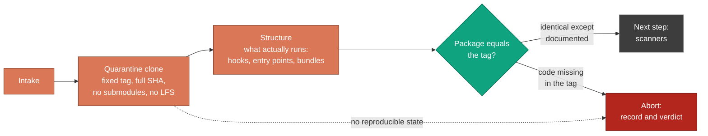
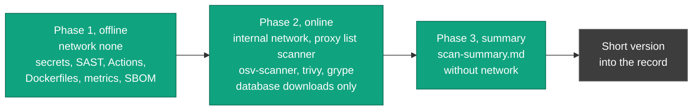
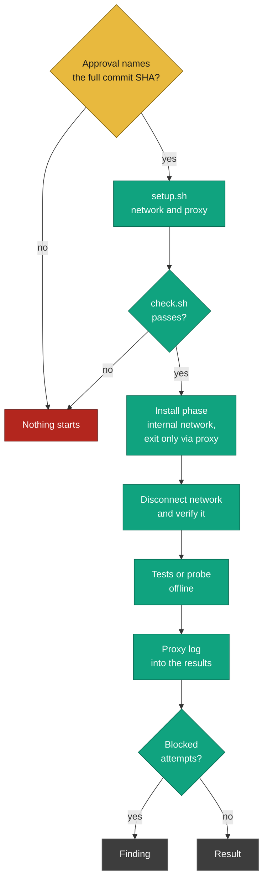
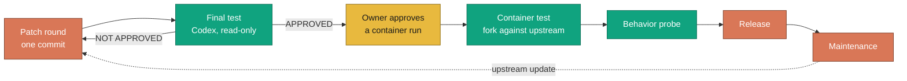
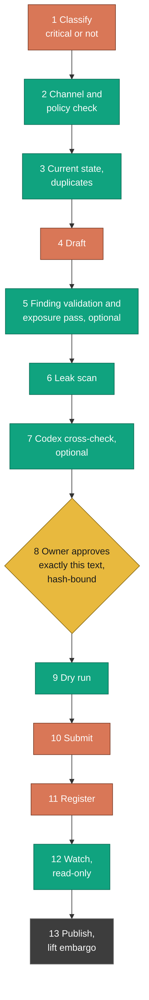
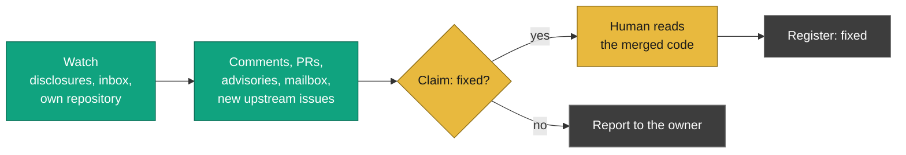
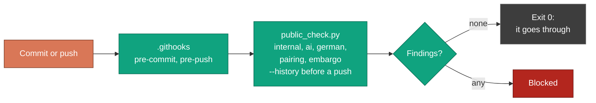

<!-- source: README.md sha256:c782b5dd00f292d5aea07b790b2c61313300fa76130e06d0afd8fe9d624ba995 -->
[English](README.md) | [Deutsch](README_de.md)

# ujc-security-checker

Eine Prüfstation für fremde Werkzeuge - GitHub-Repositories, Claude-Code-Plugins, Skills,
MCP-Server, CLI-Werkzeuge, Python- und npm-Pakete. Sie hilft zu entscheiden, ob ein Werkzeug auf
die eigenen Entwicklerrechner darf, und - wenn es sich lohnt, aber so nicht sicher ist - es als
privaten, gehärteten Fork zu übernehmen, zu korrigieren, zu testen und einzurichten.

Prüfszenario: ein Entwicklerrechner (Windows 11) mit Claude Code und Codex CLI, Wächter-Hooks,
verbindlichen globalen Regeln und mehreren parallelen Sitzungen je Repository.

Lizenz: MIT ([`LICENSE`](LICENSE)). Sicherheitsmeldungen zu diesem Repository: [`SECURITY.md`](SECURITY.md).

> **Neu hier?** Der [Einstieg](docs/GETTING-STARTED_de.md) erklärt ohne Vorkenntnisse, worum es geht, warum man es heute braucht, welche Werkzeuge wofür laufen, wie neue und schon installierte Werkzeuge geprüft werden und wie es mit [claudex-loop](https://github.com/ujconsulting/claudex-loop) zusammenspielt. English: [Getting started](docs/GETTING-STARTED.md).

## Was es leistet

- **Prüfablauf** - ein dokumentierter Ablauf von der Aufnahme bis zur Pflege, mit
  Abbruchkriterien je Schritt; Audits und Prüfrunden bleiben lokal unter `private/records/<name>/`,
  eine kurze öffentliche Zusammenfassung je geprüftem Werkzeug steht unter [`repos/`](repos/) (Skill [`tool-review`](.claude/skills/tool-review/README_de.md)).
- **Quarantäne und Lieferkette** - Klone auf einem festen Tag, nie ausgeführt; das veröffentlichte
  Paket wird mit dem Tag verglichen, Bundles mit dem Quelltext.
- **Scanner** - alle statischen Scanner (Secrets, SAST, GitHub Actions, Dockerfiles, Metriken,
  SBOM, Schwachstellen-Datenbanken) laufen in einem gepinnten Scanner-Image, nicht auf dem Host
  ([`tools/scan.sh`](tools/README_de.md), [`tools/scanner-image/`](tools/scanner-image/README_de.md)).
- **Sandbox mit Egress-Kontrolle** - Container bekommen nie das Standard-Bridge-Netz;
  Installation nur in einem internen Docker-Netz hinter einem Squid-Proxy mit Allowlist (LAN
  gesperrt), danach wird das Netz getrennt und die Trennung geprüft; jeder geblockte Versuch ist
  ein Befund ([`tools/egress/`](tools/egress/README_de.md), Skills
  [`sandbox-setup`](.claude/skills/sandbox-setup/README_de.md) und
  [`docker-sandbox`](.claude/skills/docker-sandbox/README_de.md)).
- **Reviews mit Codex und CodeRabbit** - derselbe Prüfauftrag geht an einen Claude-Sub-Agenten und
  an Codex (nur lesend über `tools/codex_ro.py` aus
  [claudex-loop](https://github.com/ujconsulting/claudex-loop)); optional ein CodeRabbit-Vollreview
  öffentlicher Repositories (`tools/cr_full_review.sh`).
- **Verhaltensprobe** - nach Freigabe läuft der Einstiegspunkt eines Werkzeugs einmal in der
  Sandbox unter strace, tcpdump und inotify: gestartete Programme, Verbindungsziele, geschriebene
  Dateien (`tools/behavior_probe.sh`).
- **Gehärtete Forks** - lohnt sich ein Werkzeug, entsteht ein privater Fork mit Patch-Runden,
  einem Bedrohungsmodell und einem Endtest je Runde. Der Fork und alles dazu bleiben privat; die
  öffentliche Zusammenfassung hier betrifft nur das Upstream-Werkzeug.
- **Meldungen mit Richtlinienprüfung** - Befunde gehen nur über Werkzeuge nach upstream, mit
  Pflichtprüfung gegen die Sicherheitsrichtlinie des Projekts, Leak-Scan und einer an den Hash
  gebundenen Einmal-Freigabe (Skill [`finding-disclosure`](.claude/skills/finding-disclosure/README_de.md),
  [`tools/disclosures/`](tools/disclosures/README_de.md)).
- **Beobachtung von Meldungen, Posteingang und eigenem Repository** - eine nur lesende Beobachtung
  verfolgt die Meldungen (Kommentare, verknüpfte PRs, Advisories, Postfach), neue Issues/PRs
  upstream und den Eingang dieses Repositorys ([`disclosures/`](disclosures/README_de.md)).
- **Öffentlich/privat-Prüfung** - `tools/public_check.py` hält interne Angaben, KI-Attribution,
  deutschen Text außerhalb von `*_de.md` und Befunde unter Embargo aus jedem Commit und Push heraus;
  unter `repos/` sind nur die Zusammenfassungen erlaubt (`README.md`, `README_de.md`).

## Schnellstart

Voraussetzungen: Python 3.10+, git, bash 4.4+ (Git Bash unter Windows; macOS: `brew install bash`), Docker 28+ mit
Linux-Containern, **ShellCheck 0.11+** (`tools/setup.sh` bricht ohne es ab), GitHub CLI `gh`.
Einzelheiten und Prüfbefehle: [`docs/SETUP_de.md`](docs/SETUP_de.md#1-voraussetzungen).

```bash
git clone https://github.com/ujconsulting/ujc-security-checker.git
cd ujc-security-checker
git config core.autocrlf false                   # Dateien sind LF
python tools/public_check.py --self-test          # Python 3.10+, nur Standardbibliothek
shellcheck --version                              # Pflicht, siehe Voraussetzungen
tools/setup.sh --check                            # Sandbox-Status (Docker); Exit 0 = bereit, Exit 1 vor der ersten Einrichtung
tools/setup.sh                                    # Egress-Netz, Proxy, Scanner-Image einrichten
python tools/codex_skills_sync.py --check         # Skills für Codex gespiegelt
```

Vollständige Installation in der richtigen Reihenfolge, jeder Schritt mit erwartetem Ergebnis:
[`docs/SETUP_de.md`](docs/SETUP_de.md). Übersicht der Skills: [`docs/SKILLS_de.md`](docs/SKILLS_de.md).

## Der Ablauf auf einer Seite

```mermaid
flowchart LR
    A["📥 INTAKE<br>repository, purpose,<br>intended use"] --> Q["🧊 QUARANTINE CLONE<br>fixed tag, full SHA,<br>never executed"]
    Q --> C["🔗 SUPPLY CHAIN<br>package against tag,<br>bundles against source"]
    C --> S["🔎 SCANNERS<br>pinned scanner image<br>tools/scan.sh"]
    S --> U["⚔️ INITIAL AUDIT<br>same brief to a Claude<br>sub-agent and Codex"]
    U --> W["📚 UPSTREAM RESEARCH<br>+ usage analysis"]
    W --> D["✍️ DECISION<br>owner, threat model"]
    D -- do not use --> R["repos/NAME/README.md<br>summary and verdict"]
    D -- harden a fork --> F["🔨 PATCH ROUND<br>private fork,<br>one commit per round"]
    F --> T["🔬 FINAL TEST<br>Codex, previous<br>findings first"]
    T -- NOT APPROVED --> F
    T -- APPROVED --> G["✍️ Owner approves<br>a sandbox run"]
    D -- use as it is --> G
    G --> K["🧪 CONTAINER TEST<br>+ BEHAVIOR PROBE<br>egress network only"]
    K --> L["🚀 RELEASE<br>private repository,<br>installation"]
    L --> M["🔁 MAINTENANCE<br>fork watch, re-apply<br>patches + final test"]
    M -. upstream update .-> F
    Q -. abort criterion met .-> R
    U -. findings,<br>on instruction only .-> P["📨 DISCLOSURE DRAFT<br>policy check, leak scan"]
    P --> H["✍️ Owner approves<br>exactly this text"]
    U --> R
    T --> R
    classDef producer fill:#d97757,stroke:#7a3a24,color:#fff
    classDef adversary fill:#10a37f,stroke:#0a6b54,color:#fff
    classDef human fill:#e8b93e,stroke:#8a6a14,color:#1a1a1a
    classDef artifact fill:#3d3d3d,stroke:#6b6b6b,color:#fff
    class A,Q,F,L,M,P producer
    class C,S,U,W,T,K adversary
    class D,G,H human
    class R artifact
```



*(Die Grafik bleibt bewusst englisch — sie ist mit der englischen Fassung identisch, damit beim Ändern nicht eine von beiden zurückbleibt.)*

**Du kommst an drei Stellen ins Spiel:** bei der Entscheidung nach dem Audit (nicht nutzen /
so nutzen / Fork härten), bei der Freigabe, bevor irgendetwas aus dem geprüften Repository in
einem Container läuft, und bei der hash-gebundenen Freigabe jedes Meldungstexts. Alles vor der
Entscheidung liest nur: der Klon wird nie ausgeführt, Scanner und Prüfer arbeiten read-only.

**Orange ist, wer am Werkzeug handelt, Grün ist, wer es prüft.** Die Farben benennen *Rollen*,
keine Produkte: Erstaudit und Endtest laufen mit Claude wie mit Codex; die prüfenden Schritte
liefern Befunde, die handelnden Klone, Patches und Entwürfe. Grau ist die Akte: die Prüfrunden
werden lokal unter `private/records/<name>/reviews/` geschrieben, das öffentliche Ergebnis ist die
Zusammenfassung `repos/<name>/README.md`.

**Gepunktete Kanten sind bedingt.** Jeder Schritt kann die Prüfung beenden, sobald sein
Abbruchkriterium aus der Tabelle unten erfüllt ist; der Grund kommt in die Akte und die Zusammenfassung. Meldungen
verlassen den Rechner nur auf Anweisung, und ein Upstream-Update startet eine neue Patch-Runde.
Durchgezogene Kanten passieren immer.

| # | Schritt | Ergebnis | Abbruch, wenn ... |
|---|---|---|---|
| 1 | **Aufnahme**: Repository, Zweck, geplanter Einsatz | lokale Akte `private/records/<name>/` | Einsatz unklar |
| 2 | **Quarantäne-Klon** auf festem Tag, Struktur: was läuft wirklich | volle SHA, Liste der Hooks/MCP/Einstiegspunkte/Bundles | kein reproduzierbarer Stand |
| 3 | **Lieferkette**: veröffentlichtes Paket gegen den Tag, Bundles gegen den Quelltext | „identisch bis auf ...“ | das Paket enthält Code, der im Tag fehlt |
| 4 | **Scanner** im Scanner-Image (`tools/scan.sh`): Secrets, SAST, Actions, Dockerfiles, Metriken, SBOM offline; Schwachstellen-DBs über den Egress-Proxy | `scan-summary.md` -> Kurzfassung in der lokalen Akte | - |
| 5 | **Erstaudit**: derselbe Prüfauftrag an einen Claude-Sub-Agenten und Codex, Befunde selbst verifiziert; optional ein CodeRabbit-Vollreview (`tools/cr_full_review.sh`, nur öffentliche Repositories, Kontingent ankündigen) und weitere Zweitmeinungen | lokal `private/records/<name>/reviews/round-01/02-...` mit `VERDICT:` | - |
| 6 | **Upstream-Recherche**: behoben, gewollt, nützliche PRs | lokal `private/records/<name>/reviews/round-NN-upstream-research.md` | - |
| 7 | **Einsatzanalyse**: wo es hilft, wo nicht | privat, nicht in diesem Repository | - |
| 8 | **Entscheidung** des Auftraggebers: nicht nutzen / so nutzen / Fork härten - mit Bedrohungsmodell | Einsatzumfang, Maßstab | „nicht nutzen“ |
| 9 | **Fork** (privat), Patch-Runden: Klassen schließen, Unnötiges abschalten | ein Commit je Runde, `UJC-PATCHES.md`; dokumentiert nur unter `private/repos/<name>/` | der Umfang wächst über das Pflegbare hinaus |
| 10 | **Endtest** je Runde (Codex `gpt-6-astra`/medium), zuerst die Befunde der Vorrunde | `FINAL TEST: ...`, Bewertung | zweimal dieselbe Befundklasse -> Maßstab klären |
| 11 | **Containertests** nach Freigabe, mit Upstream-Vergleich; **Verhaltensprobe** (`tools/behavior_probe.sh`) nach Freigabe je Werkzeug - beide nur im Egress-Netz, Netz danach getrennt | lokal `reviews/round-NN-container-test.md`, `...-behavior-probe.md` unter `private/records/<name>/` | geblockte Egress-Versuche ohne Erklärung |
| 12 | **Freigabe**: Push ins private Repository, Installation, `docs/ujc/UJC-USAGE.md` im Fork | Einsatz in privaten Notizen; öffentliches Ergebnis: die Zusammenfassung `repos/<name>/README_de.md` (aus `templates/repo-README.md`) | - |
| 13 | **Pflege**: Fork-Beobachtung, Update = Patches neu anwenden + Endtest | neue Runden | - |
| 14 | **Meldungen an Upstream** nur auf Anweisung | erst der Entwurf | - |

Volltext mit Befehlen, Lehren und Fallstricken: Skill [`tool-review`](.claude/skills/tool-review/README_de.md)
(maßgeblich ist `SKILL.md`, englisch). Regeln für Agenten: [`CLAUDE.md`](CLAUDE.md) (Claude Code) und
[`AGENTS.md`](AGENTS.md) (Codex als Reviewer); Vorlagen: [`templates/`](templates/); Werkzeuge:
[`tools/README_de.md`](tools/README_de.md).

## So funktioniert jeder Teil

Das Diagramm oben zeigt den ganzen Ablauf; die folgenden Diagramme zeigen je einen Teil. Die Farben
sind dieselben: Orange handelt, Grün prüft, Gelb ist eine Entscheidung eines Menschen, Grau ist der
Bericht, Rot hält an.

### Quarantäne-Klon und Lieferkette

Das Werkzeug wird auf einem festen Tag geklont und nie ausgeführt. Was Anwender tatsächlich
installieren, ist das veröffentlichte Paket; deshalb wird es mit dem Tag verglichen, Bundles mit dem
Quellcode.



### Scanner

Alle statischen Scanner laufen im fixierten Scanner-Image: zuerst offline, dann nur für die
Datenbank-Downloads über den Egress-Proxy (Liste `scanner`), danach die Zusammenfassung
(`tools/scan.sh`).



### Sandbox mit Egress-Kontrolle

Fremder Code läuft nur nach einer Freigabe, die die vollständige Commit-SHA nennt, nur im internen
Netz hinter dem Proxy und nach der Installation ganz ohne Netz. Jeder blockierte Versuch ist ein
Befund.



### Gehärteter Fork

Ein privater Fork wird in Runden gepatcht, jede Runde prüft jemand, der sie nicht geschrieben hat,
und jedes Upstream-Update startet den Kreislauf neu. Der Fork selbst bleibt privat.



### Meldung an Upstream

Ein Befund geht nur über eine feste Kette an Upstream, mit einer per Hash gebundenen
Einmal-Freigabe für genau diesen Text.



### Überwachung von Meldungen, Eingang und eigenem Repository

Die Überwachung liest nur. Kommentare sind Behauptungen: „fixed“ wird im Register erst gesetzt,
nachdem ein Mensch den gemergten Code gelesen hat.



### Prüfung auf öffentlich/privat

Vor jedem Commit und Push hält `tools/public_check.py` interne Angaben, KI-Herkunftsangaben,
deutschen Text außerhalb von `*_de.md` und Befunde unter Embargo aus dem öffentlichen Repository
heraus.



## Sicherheitsregeln

- **Nichts aus einem geprüften Repository wird installiert oder ausgeführt**, bevor der
  Auftraggeber es ausdrücklich freigibt - kein `pip`/`npm install`, kein Build, Test, Import oder
  Skript. Tests laufen nur im isolierten Container, und dieser bekommt Netz nur über den
  Egress-Proxy (Allowlist, LAN gesperrt), danach gar keines mehr.
- **Nichts verlässt den Rechner ohne Freigabe**: kein Push, kein Issue, Kommentar, Advisory oder
  Mail ohne ausdrückliche Anweisung; Meldungen brauchen eine an den Hash genau dieses Texts
  gebundene Freigabe.
- **Embargo**: Material zu kritischen Befunden bleibt im gitignorierten Ordner `private/`, bis
  upstream einen Fix oder ein Advisory veröffentlicht hat.
- **Öffentliches Repository**: keine lokalen Pfade, LAN-Adressen, internen Hostnamen, Namen
  nicht-öffentlicher eigener Projekte oder Kunden in versionierten Dateien; `tools/public_check.py`
  setzt das vor jedem Commit und Push durch (Git-Hooks in `.githooks/`).
- **Kommentare sind Behauptungen**: „behoben“ setzt nur ein Mensch, nachdem er den gemergten Code
  gelesen hat.

## Skills (`.claude/skills/`)

| Skill | wofür |
|---|---|
| [`tool-review`](.claude/skills/tool-review/README_de.md) | der ganze Ablauf von der Aufnahme bis zur Pflege |
| [`usage-analysis`](.claude/skills/usage-analysis/README_de.md) | wo das Werkzeug in Ihren Projekten hilft und wo nicht (Ergebnis privat) |
| [`finding-disclosure`](.claude/skills/finding-disclosure/README_de.md) | Befunde nach upstream melden, Antworten und Fixes verfolgen, Eingang des eigenen Repositorys und Postfach |
| [`mcp-build`](.claude/skills/mcp-build/README_de.md) | eigene MCP-Server bauen, fremde übernehmen - Hausregeln |
| [`sandbox-setup`](.claude/skills/sandbox-setup/README_de.md) | Egress-Netz, Proxy und Scanner-Image einrichten, prüfen, abbauen (`tools/setup.sh`) |
| [`docker-sandbox`](.claude/skills/docker-sandbox/README_de.md) | Wegwerf-Container für Installation, Tests und Verhaltensprobe (nur über den Egress-Proxy) |
| [`proxmox-lxc-sandbox`](.claude/skills/proxmox-lxc-sandbox/README_de.md) | Wegwerf-LXC auf Proxmox, wenn Docker nicht reicht |

Die Agenten laden `SKILL.md`; `README.md` / `README_de.md` daneben sind kurze Dokus für Menschen.
Codex CLI findet die Skills unter `.agents/skills/` (erzeugt von
`python tools/codex_skills_sync.py`), siehe [`AGENTS.md`](AGENTS.md). Übersicht:
[`docs/SKILLS_de.md`](docs/SKILLS_de.md).

## Verzeichnis der geprüften Repositories

| Repository | Upstream @ festgehaltene Version | Geprüft | Urteil | Empfehlung |
|---|---|---|---|---|
| [agents-office](repos/agents-office/README_de.md) | `ajsahni/agents-office` @ `v3.2.1-beta.2` | 12.10.2026 | `DO NOT USE` | nicht einsetzen |
| [graphify](repos/graphify/README_de.md) | `Graphify-Labs/graphify` @ `v0.9.76` | 04.10.2026 | `USABLE WITH CONDITIONS` (Codex) | nur mit Auflagen |
| [oh-my-claudecode](repos/oh-my-claudecode/README_de.md) | `Yeachan-Heo/oh-my-claudecode` @ `v5.6.1` | 04.10.2026 | `DO NOT USE` (Codex) | nicht einsetzen |
| [paperclip](repos/paperclip/README_de.md) | `paperclipai/paperclip` @ `v2026.1005.0` | 12.10.2026 | `DO NOT USE` (Claude + Codex) | nicht einsetzen |
| [herald-os](repos/herald-os/README_de.md) | `iamlukethedev/Herald-OS` @ `v0.1.0-alpha.3` | 12.10.2026 | `DO NOT USE` (Claude) | nicht einsetzen |
| [context-mode](repos/context-mode/README_de.md) | `mksglu/context-mode` @ `v1.0.169` | 21.10.2026 | `DO NOT USE` (Claude + Codex) | nicht einsetzen |
| [rustdesk](repos/rustdesk/README_de.md) | `rustdesk/rustdesk` @ `1.5.0` | 31.10.2026 | `USABLE WITH CONDITIONS` (Claude; Codex ausstehend) | nur mit Auflagen |
| [rustdesk-server](repos/rustdesk-server/README_de.md) | `rustdesk/rustdesk-server` @ `1.1.16` | 31.10.2026 | `USABLE WITH CONDITIONS` (Claude; Codex ausstehend) | nur mit Auflagen |
| [handy](repos/handy/README_de.md) | `cjpais/Handy` @ `v0.9.8` | 31.10.2026 | `USABLE WITH CONDITIONS` (Claude + Codex) | nur mit Auflagen |
| [voicestudio](repos/voicestudio/README_de.md) | `debpalash/VoiceStudio` @ `v0.5.7` | 31.10.2026 | `USABLE WITH CONDITIONS` (Claude + Codex) | nur mit Auflagen |
| [mirofish](repos/mirofish/README_de.md) | `666ghj/MiroFish` @ `v0.1.2` | 31.10.2026 | `DO NOT USE` (Claude + Codex) | nicht einsetzen |
| [linkedin-skills](repos/linkedin-skills/README_de.md) | `sergebulaev/linkedin-skills` @ `v1.1.28` | 31.10.2026 | `USABLE WITH CONDITIONS` (Claude; Codex-Runde offen) | nur mit Auflagen |
| [openwhispr](repos/openwhispr/README_de.md) | `OpenWhispr/openwhispr` @ `v1.11.0` | 31.10.2026 | `USABLE WITH CONDITIONS` (Claude; Codex-Runde offen) | nur mit Auflagen |

Die Bewertungen sind statische Prüfungen genau der genannten Version und keine Garantie. Sie betreffen
nur das Upstream-Werkzeug; wird ein Werkzeug als eigene Fassung übernommen, bleibt alles dazu privat.

## Aufbau

```text
README.md, README_de.md                Projektübersicht (englisch, deutsch)
LICENSE, SECURITY.md                   MIT-Lizenz, Melden von Schwachstellen
CLAUDE.md, AGENTS.md                   Regeln für Claude Code, Codex als Reviewer
docs/                                  SETUP.md (Installation), SKILLS.md (Skill-Übersicht), GETTING-STARTED.md (Einsteigerleitfaden), je mit _de.md
.claude/skills/<name>/                 SKILL.md (für die Agenten), README.md / README_de.md (für Menschen)
.agents/skills/                        Codex-Spiegel der Skills (erzeugt)
.githooks/                             pre-commit / pre-push: Öffentlich/privat-Prüfung
repos/<name>/README.md, README_de.md   öffentliche Zusammenfassung je geprüftem Werkzeug: Version, Urteil, Empfehlung, Bewertung
templates/                             Akte, Prüfauftrag, Bedrohungsmodell, Patch-Satz, Endtest, Fork-Gerüste, Entwürfe
tools/                                 setup.sh, scan.sh, cr_full_review.sh, Container-Skripte, egress/, scanner-image/,
                                       disclosures/, codex_ro.py, codex_skills_sync.py, public_check.py
disclosures/                           Umgang dieses Repositorys mit dem eigenen Eingang (README)
private/                               lokale Betriebsdetails (gitignoriert): records/<name>/{reviews,disclosures}/
                                       (Audits, Runden, Recherche, Entwürfe, Register), eigene Fassungen (private/repos/<name>/:
                                       Patch-Runden, Endtests, Changelog), Einsatzanalysen, Material unter Embargo
```

Rohmaterial eines Forks (Prüfaufträge, wörtliche Reviewer-Berichte, Patch-Spezifikationen) liegt
im Fork unter `docs/ujc/audit/`, die Begründungen der Patches in dessen `UJC-PATCHES.md`; Runden,
Changelog und Stand der eigenen Fassung liegen unter `private/repos/<name>/`, nicht in diesem Repository.

## Zusammenspiel mit claudex-loop

[claudex-loop](https://github.com/ujconsulting/claudex-loop) ist das Schwesterprojekt. Beide
folgen derselben Lehre, dass nie der prüft, der etwas gemacht hat, aber sie prüfen Verschiedenes:

| | claudex-loop | ujc-security-checker |
|---|---|---|
| **Was geprüft wird** | Der eigene Plan und die eigene Änderung, während sie entsteht | Das Werkzeug eines anderen, bevor es installiert wird |
| **Wann** | Vor dem Bau (Plan-Review) und danach (Inspektion, Abnahmetor) | Vor dem ersten Einsatz und nach jedem Upstream-Update |
| **Ergebnis** | Ein freigegebener Plan, eine abgenommene Änderung, eine Basislinie bekannter Altlasten | Ein Bericht mit Urteil je Werkzeug, möglicherweise ein gehärteter Fork, möglicherweise eine Meldung |
| **Fremder Code läuft** | Der eigene Code läuft nur in einem gehärteten Container ohne Netz | Nie auf dem Rechner; nach Freigabe einmal im Container, Installation nur über den Proxy |
| **Verlässt den Rechner** | Nichts außer dem, was die Prüfer lesen | Meldungen, nur mit einer an den Hash gebundenen Freigabe |

Ein Werkzeug, das Teil eines Projekts werden soll, geht zuerst durch den Checker; erst danach wird es
eingebaut, und diese Änderung geht durch claudex-loop. Einzelheiten und ein Diagramm:
[Einstieg, Abschnitt 13](docs/GETTING-STARTED_de.md#13-zusammenspiel-mit-claudex-loop).

## Meldungen an Upstream

Befunde gehen an den Kanal, den das Upstream-Projekt nennt, und werden lokal verfolgt (Entwürfe,
Register und Beobachtungsberichte liegen unter `private/`, nicht in diesem Repository). Wie dieses
Repository seinen eigenen Eingang behandelt: [`disclosures/README_de.md`](disclosures/README_de.md). Ablauf und Regeln: Skill
[`finding-disclosure`](.claude/skills/finding-disclosure/README_de.md), Werkzeuge:
[`tools/disclosures/`](tools/disclosures/README_de.md).
