<!-- approval: owner, 2026-11-02 -->
[English](GETTING-STARTED.md) | [Deutsch](GETTING-STARTED_de.md)

# ujc-security-checker: getting started

This page explains ujc-security-checker to people who see it for the first time: what it does,
why it matters, how you use it and where its limits are. It assumes no prior knowledge of the
tools involved. Pointers to the technical documentation are in the text and collected under
[Further reading](#16-further-reading).

**Contents**

1. [What is it about?](#1-what-is-it-about)
2. [Why does anyone need this today?](#2-why-does-anyone-need-this-today)
3. [The core rule: nothing foreign runs before it is understood](#3-the-core-rule-nothing-foreign-runs-before-it-is-understood)
4. [The tools and what they are for](#4-the-tools-and-what-they-are-for)
5. [The building blocks](#5-the-building-blocks)
6. [A new tool, before its first use](#6-a-new-tool-before-its-first-use)
7. [Tools that are already in use](#7-tools-that-are-already-in-use)
8. [Building cleanly: hardened forks and own MCP servers](#8-building-cleanly-hardened-forks-and-own-mcp-servers)
9. [How a fix is checked afterwards](#9-how-a-fix-is-checked-afterwards)
10. [How it is attacked and tested](#10-how-it-is-attacked-and-tested)
11. [Wiring it in: prerequisites, setup, first review](#11-wiring-it-in-prerequisites-setup-first-review)
12. [What it costs and what you should know](#12-what-it-costs-and-what-you-should-know)
13. [How it fits with claudex-loop](#13-how-it-fits-with-claudex-loop)
14. [What it is not](#14-what-it-is-not)
15. [Terms](#15-terms)
16. [Further reading](#16-further-reading)

---

## 1. What is it about?

Developers install other people's software every day: a plugin for Claude Code, a skill, an MCP
server that gives the AI access to a database, a command-line tool from GitHub, a Python or npm
package. Each of these runs with the rights of the developer. It can read the project, the SSH
keys and the tokens in the user profile, and it can send all of that anywhere.

ujc-security-checker is a **review station for such tools**. Before a tool goes onto a developer
machine, it runs through a fixed procedure here:

- it is cloned on a fixed version and **never executed** while it is being read;
- the published package is compared with the source it claims to come from;
- a set of scanners and two independent reviewers look for weaknesses;
- the owner decides: **do not use**, **use as it is**, or **harden a private fork** first;
- only after an explicit approval does the tool run once, in an isolated container, while every
  started program, every connection attempt and every written file is recorded.

The full record stays local; the public result is a short summary per tool with a verdict, under
[`repos/`](../repos/). Findings can
be reported to the original project, but only through a controlled channel.

**In one sentence for developers:** a documented review pipeline for third-party developer
tools (quarantine clone, supply-chain comparison, pinned scanner image, dual-model audit,
egress-controlled container tests and behavior probe), with hardened private forks and
policy-checked, hash-approved disclosure.

## 2. Why does anyone need this today?

### Where things stand

AI coding tools have made it normal to install extensions that act on their own: hooks that run
before every command, MCP servers that read and write data, skills that tell the agent what to do.
Many of them are young projects, maintained by one person, released weekly, and installed with a
single command that fetches whatever the newest version is today.

### The risks

| Risk | What happens | What the checker does against it |
|---|---|---|
| **Malicious or compromised package** | An install script runs during `npm install` or a Python build and sends tokens to a stranger | Nothing is installed on the host; installation only in a container whose only exit is a proxy with an allowlist |
| **Package differs from the source** | The code on GitHub looks clean, the published package contains something else | The package is compared file by file with the tagged source; bundles are compared with a rebuild |
| **Silent network traffic** | The tool phones home, checks for updates, sends telemetry or loads code at runtime | Behavior probe records every connection; every blocked attempt is a finding |
| **Too many rights** | An MCP server or hook can read everything the agent can read, and its output steers the model | Audit of what actually runs (hooks, entry points, tool descriptions); disable what is not needed in a fork |
| **Prompt injection** | Text in a tool description, a web page or an issue tells the agent to do something else | Tool output and descriptions are treated as data; the review looks for exactly these paths |
| **Moving versions** | "Latest" today is not what was reviewed yesterday | Review on a fixed commit; approvals are bound to the full commit SHA; maintenance re-runs the checks |

### The opportunities and the benefit

The aim is to install with a reason. A tool that passed the review can
be used with confidence and with known conditions. A tool that is useful but unsafe can still be
used, as a hardened fork. And the records add up: after a few reviews you know which kinds of
problems keep coming back and where to look first.

## 3. The core rule: nothing foreign runs before it is understood

Three rules carry everything else:

1. **Read before run.** A reviewed tool is read, scanned and reviewed. It is not installed, built,
   tested or imported until the owner approves exactly that revision.
2. **Two reviewers, then a human.** The same audit brief goes to two different models (a Claude
   sub-agent and Codex, read-only). Their findings are checked against the code. The decision is
   made by the owner, not by a model.
3. **Nothing leaves the machine by accident.** No push, no issue, no advisory, no mail without an
   explicit instruction; a disclosure needs an approval that is bound to the hash of exactly that
   text.



**Green is who checks, yellow is where a human decides, grey is the written record.** The colors
name roles, not products.

## 4. The tools and what they are for

| Tool | What it is | What it does here |
|---|---|---|
| **Claude Code** | Anthropic's AI coding assistant in the terminal | Runs the review procedure (skills), writes the records, acts as one of the two reviewers |
| **Codex CLI** | OpenAI's coding assistant in the terminal | Second reviewer, always read-only through the wrapper `tools/codex_ro.py` from [claudex-loop](https://github.com/ujconsulting/claudex-loop) |
| **Docker** | Container runtime | Runs scanners and, after approval, the tool itself, isolated from the machine |
| **Squid proxy** | Web proxy | The only exit of a sandbox container; lets through only allowlisted package sources, blocks the local network |
| **Scanner image** `ujc-scanner` | One locally built image with all scanners, every download verified by hash | Keeps the scanners themselves off the host |
| **gitleaks, trufflehog** | Secret scanners | Find keys and passwords in the code and its history (no verification calls to providers) |
| **semgrep, bandit, ruff** | Static code analysis | Find dangerous patterns such as shell injection or unsafe deserialization |
| **guarddog** | Heuristics for malicious packages | Flags typical malware tricks in Python and npm packages |
| **osv-scanner, trivy, grype, syft** | Vulnerability databases and SBOM | List the dependencies and their known vulnerabilities |
| **zizmor, actionlint, hadolint, shellcheck** | Linters for workflows, Dockerfiles, shell | Find weaknesses in CI pipelines and scripts |
| **strace, tcpdump, inotify** | Linux observation tools | Record programs, connections and file writes during the behavior probe |
| **GitHub CLI** `gh` | Command line for GitHub | Reads advisories, issues and policies; submits approved disclosures |
| **CodeRabbit** (optional) | AI review service | A further second opinion on public repositories, opt-in, costs quota |

## 5. The building blocks

The procedure is written as **skills**: instructions that Claude Code (and Codex, through a
mirror) follows step by step. A skill is executable documentation: its commands are meant to be
run, not just read.

| Skill | For |
|---|---|
| `tool-review` | The whole procedure, from intake to maintenance |
| `usage-analysis` | Where the tool would help in your projects and where not (result stays private) |
| `finding-disclosure` | Report findings upstream with a policy check, a leak scan and a hash-bound approval; watch the answers |
| `mcp-build` | House rules for own MCP servers and for adopting third-party ones |
| `sandbox-setup` | Set up, check and remove the sandbox (network, proxy, scanner image) |
| `docker-sandbox` | Rules and pattern for throwaway containers that run foreign code |
| `proxmox-lxc-sandbox` | A throwaway Linux container on Proxmox when Docker is not enough |

Next to the skills, a few scripts enforce what must not depend on discipline:

- `tools/quarantine_clone.py` clones on a fixed commit and refuses everything that would execute
  code from the clone.
- `tools/scan.sh` runs every scanner in the scanner image, first without network, then for the
  database downloads only via the proxy.
- `tools/container_test_*.sh` and `tools/behavior_probe.sh` refuse to start without an approval
  that names the full commit SHA.
- `tools/public_check.py` runs before every commit and push and keeps internal details out of the
  public repository.
- `tools/ledger.py` records every decision, every review run and every finding as metadata.

Full list: [`docs/SKILLS.md`](SKILLS.md) and [`tools/README.md`](../tools/README.md).

## 6. A new tool, before its first use

This is the normal case: somebody wants to use a tool that nobody here has used before.



1. **Intake.** What is the tool, what should it do for us, where would it run? If that is unclear,
   the review stops here.
2. **Quarantine clone.** The tool is cloned on a fixed tag into `quarantine/`, without submodules
   and without large files. Nothing in it is started, no environment of it is activated. The first
   job is to find out what actually runs: hooks, entry points, MCP definitions, bundled files.
3. **Supply chain.** What users actually install is the published package, not the GitHub source.
   Both are compared. If the package contains code the tag does not, the review ends.
4. **Scanners.** All scanners run in one pass; the summary goes into the record.
5. **Initial audit.** The same written brief goes to a Claude sub-agent and to Codex. Every finding
   is checked against the code before it counts.
6. **Upstream research.** Is a finding already known, already fixed, or declared "by design"?
7. **Usage analysis.** Where would the tool really help, and is it worth the risk?
8. **Decision.** The owner decides, with a short threat model: who could attack, through which
   path, with what damage.

Every step has an abort criterion, listed in the [README](../README.md#the-process-on-one-page).
A review that stops early is a result, not a failure: the record says why.

## 7. Tools that are already in use

Most teams already have tools installed that nobody reviewed. The procedure is the same; only the
starting point differs:

- **Take stock.** List what is installed on the developer machines: Claude Code plugins and skills,
  MCP servers, global npm and Python tools, editor extensions with their own processes.
- **Order by reach.** Start with what can do the most: hooks that run before every command, MCP
  servers with write access or network, anything that sees credentials.
- **Review the installed version.** The quarantine clone uses exactly the tag that is installed,
  so the verdict is about what really runs.
- **Decide again.** Keep, restrict (for example, switch off a feature), replace with a hardened
  fork, or remove.



**Maintenance** is part of the procedure: every upstream update is a new
version that has not been reviewed. A fork watch reports new releases; the patches are applied
again and the final test runs again.

## 8. Building cleanly: hardened forks and own MCP servers

When a tool is worth having but not safe as shipped, it is adopted as a **private, hardened
fork**:

- **Close classes, not single holes.** If one shell call is injectable, all shell calls of that
  kind are fixed in the same round.
- **Disable what is not needed.** An auto-update check, telemetry, a remote feature nobody uses:
  switched off at the entry point, with a test that proves it stays off.
- **One commit per patch round**, a file `UJC-PATCHES.md` that gives the reason for every patch,
  and a threat model for the fork.
- **Keep it maintainable.** If the scope grows beyond what can be carried forward with each
  upstream release, that is an abort criterion.

Everything about an own version stays private. The public summary in this repository only covers the
upstream tool as it is shipped.

For **own MCP servers**, the skill `mcp-build` sets the house rules: stdio by default; HTTP only on
loopback or an approved internal address, with authentication and an origin check; no secrets in
code or `.mcp.json`; minimal rights per tool, writing tools never auto-allowed; registration per
project, never global; pinned dependencies; and tool output is data, never instructions.

## 9. How a fix is checked afterwards

A patch round is not finished when the code is written. It is finished when someone who did not
write it has checked it:



1. **Final test.** A fresh Codex session checks the round, starting with the findings of the
   previous round: are they really closed? The answer ends in `FINAL TEST: APPROVED` or
   `NOT APPROVED`. The same finding class twice means the standard has to be clarified, not
   patched again.
2. **Container test.** The test suite of the fork runs in the container, and so does the test suite
   of the unmodified upstream version. A red test only counts as a finding if it is green upstream.
3. **Behavior probe.** The entry point of the tool runs once, while every started program, every
   connection and every written file is recorded.
4. **Release.** Push to the private repository, installation, usage notes in the fork.

## 10. How it is attacked and tested

The sandbox is built on one assumption: **the tool under review is hostile until shown
otherwise.**



| Protection | Effect |
|---|---|
| **Never Docker's default network** | Containers never see the local network, the Docker host or other containers |
| **Proxy with allowlist** | During installation only package sources are reachable; private address ranges are always blocked |
| **`check.sh` before every run** | Checks both directions (allowed sources reachable, everything else blocked); if it fails, nothing starts |
| **Network off after installation** | Tests and probe run without network; the disconnection is verified, also against the proxy |
| **Approval bound to the SHA** | A moved tag or branch cannot slip in a different revision |
| **Container hardening** | No capabilities, no privilege escalation, memory, CPU and process limits, a disk watchdog |
| **One sandbox run at a time** | Runs cannot reach each other's containers or folders |

**What counts as a finding:** a blocked connection attempt, a written file outside the expected
places, a started program nobody expected, a test that is red only in the fork, a difference
between package and source, a scanner hit that survives reading the code.

## 11. Wiring it in: prerequisites, setup, first review

### Prerequisites (once per machine)

| What | Why |
|---|---|
| Python 3.10+ and git | All tools; the gate needs only the standard library |
| bash 4.4+ (Git Bash on Windows, `brew install bash` on macOS) | The sandbox scripts |
| Docker 28+ with Linux containers | Scanners and container runs |
| ShellCheck 0.11+ | `tools/setup.sh` stops without it |
| GitHub CLI `gh`, logged in | Advisories, policies, approved disclosures |
| Claude Code; Codex CLI (optional) | The reviewers (Codex is the second, read-only one) |

### Setup

```bash
git clone https://github.com/ujconsulting/ujc-security-checker.git
cd ujc-security-checker
git config core.autocrlf false                   # files are LF
python tools/public_check.py --self-test          # Python 3.10+, standard library only
shellcheck --version                              # required, see prerequisites
tools/setup.sh --check                            # sandbox status (Docker); exit 0 = ready
tools/setup.sh                                    # set up egress network, proxy, scanner image
python tools/codex_skills_sync.py --check         # skills mirrored for Codex
```

The complete installation, each step with its expected result, is in
[`docs/SETUP.md`](SETUP.md), including the local configuration in the git-ignored `private/`
folder and the git hooks of the public/private gate.

### The first review

Start Claude Code in the checker root and name the tool and its purpose, for example *"review
owner/name, intended as an MCP server for project documentation"*. The skill `tool-review` takes
over from there: it creates the record, clones, scans and prepares the audit brief. You come in
at three points:

1. the **decision** after the audit;
2. the **approval** before anything from the tool runs in a container;
3. the **approval of every disclosure text**, if findings are to go upstream.

## 12. What it costs and what you should know

- **Licenses.** The checker itself is free (MIT). Claude Code and Codex need their own
  subscriptions.
- **Quota.** Every Codex review consumes quota; the rule is one run per quota window, one after
  another, never in parallel. CodeRabbit is optional and has its own quota.
- **Data leaving the machine.** What a reviewer reads goes to its provider (Anthropic or OpenAI).
  The vulnerability scanners send package names and versions, no code. CodeRabbit receives code
  and is therefore opt-in; non-public code needs an explicit approval for exactly that revision.
- **Machine.** Docker with Linux containers; the scanner image is about 2.4 GB.
- **Time.** A first review of a small tool takes a few hours including the reviewer rounds; a
  hardened fork takes rounds, and each upstream update costs another one.
- **Public and private.** The repository is built to be public. Internal details (local paths,
  internal addresses, names of non-public projects or customers) live only in the git-ignored
  `private/` folder, and the gate refuses commits that contain them.

## 13. How it fits with claudex-loop

[claudex-loop](https://github.com/ujconsulting/claudex-loop) is the sister project. Both follow the
same doctrine, that whoever made something never checks it, but they check different things:

| | claudex-loop | ujc-security-checker |
|---|---|---|
| **What is checked** | Your own plan and your own change, while it is being built | Someone else's tool, before it is installed |
| **When** | Before the build (plan review) and after it (inspection, acceptance gate) | Before first use and after every upstream update |
| **Result** | An approved plan, an accepted change, a baseline of known debt | A record with a verdict per tool, possibly a hardened fork, possibly a disclosure |
| **Foreign code runs** | Your own code runs only in a hardened container without network | Never on the machine; after approval once in a container, installation via the proxy only |
| **Leaves the machine** | Nothing beyond what the reviewers read | Disclosures, only with a hash-bound approval |

They work together:



- A tool that is to become part of a project (dependency, plugin, MCP server) goes through the
  checker first. Only then is it built in, and that change goes through claudex-loop.
- The checker uses claudex-loop's parts: every Codex call goes through its read-only wrapper
  (`tools/codex_ro.py` is a copy), and with `claudex_audit_mode=audit` the Codex half of the
  initial audit is claudex-loop's `/audit` skill.
- claudex-loop's dependency audit lists known vulnerabilities of a project's dependencies. It does
  not tell you whether a package is malicious or what it does during installation; that is the
  checker's job.

## 14. What it is not

So that nobody expects more than is delivered:

- **Not a guarantee.** Two reviewers and a dozen scanners find a lot, not everything. A tool with
  a clean record can still contain something nobody found.
- **Not a penetration test** of running systems, and not a replacement for a security process on
  high-stakes software.
- **Not an antivirus.** It does not watch the machine; it reviews tools before they get there.
- **A container is not a separate machine.** It runs on the machine's Docker with strict settings.
  When that is not enough, the skill `proxmox-lxc-sandbox` moves the run to a separate host.
- **No automatic disclosure.** Nothing goes upstream without a human approving exactly that text.

## 15. Terms

| Term | Meaning |
|---|---|
| **Allowlist** | The list of domains the proxy lets through; everything else is blocked |
| **Behavior probe** | One observed run of the tool's entry point in the container |
| **Bundle** | A pre-built, often minified file shipped in a package instead of readable source |
| **Disclosure** | Reporting a finding to the original project |
| **Egress** | Outgoing network traffic |
| **Embargo** | A critical finding stays private until the original project has published a fix |
| **Final test** | The check of a patch round by a reviewer who did not write it |
| **Fork** | A copy of a project that is maintained separately |
| **Hook** | A small program a tool runs automatically before or after certain actions |
| **MCP server** | A program that gives an AI assistant access to data or functions |
| **Quarantine clone** | A copy of the tool on a fixed version that is read but never executed |
| **Record** | The written result of a review, kept locally under `private/records/<name>/`; the public part is the summary `repos/<name>/README.md` |
| **SBOM** | Software bill of materials: the list of everything a package contains |
| **SHA** | The unique fingerprint of a commit; approvals name it in full |
| **Supply chain** | The way from the source code to what is actually installed |
| **Upstream** | The original project a tool comes from |

## 16. Further reading

- [README](../README.md): the process on one page, the diagrams of each part, the index of all
  reviewed tools
- [`docs/SETUP.md`](SETUP.md): the complete installation with a verification checklist
- [`docs/SKILLS.md`](SKILLS.md): all skills, when to use them, their commands
- [`tools/README.md`](../tools/README.md): every script, its settings and its results
- [`tools/egress/README.md`](../tools/egress/README.md): the network and proxy design and its limits
- [`disclosures/README.md`](../disclosures/README.md): how this repository handles its own inbox
- [`SECURITY.md`](../SECURITY.md): how to report a vulnerability in this repository
- [claudex-loop](https://github.com/ujconsulting/claudex-loop): the sister project for your own code
