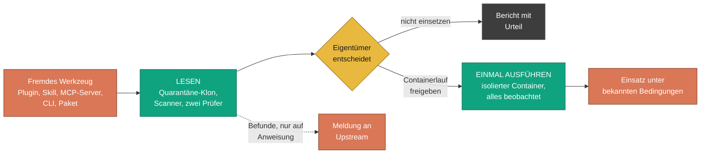
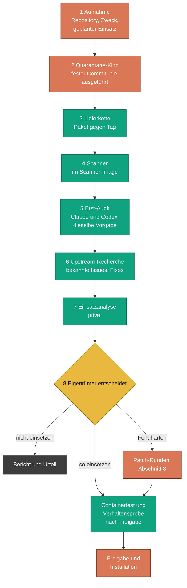
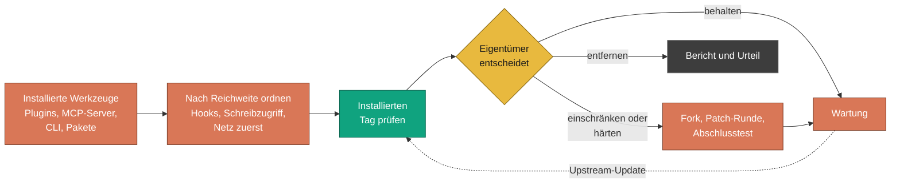
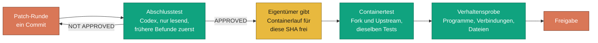
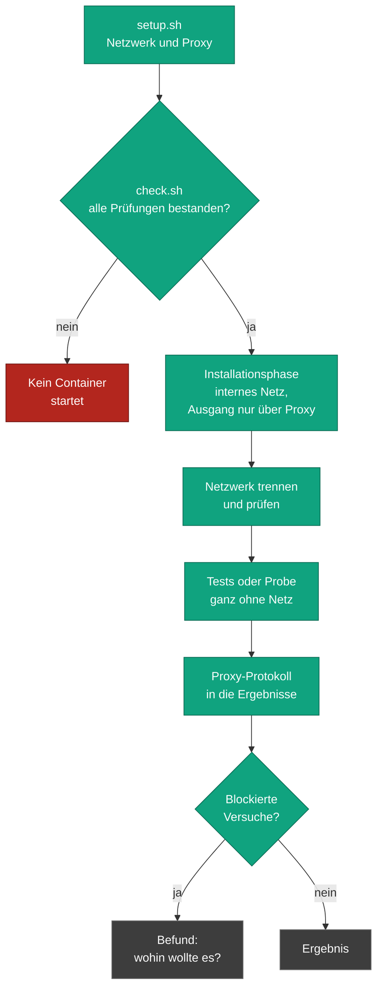
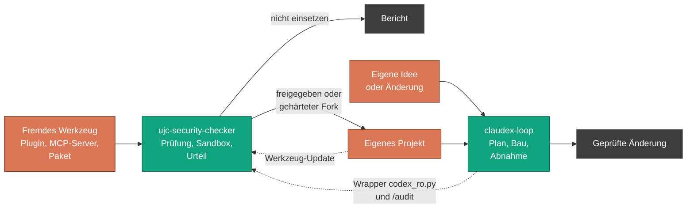

<!-- source: GETTING-STARTED.md sha256:7159108dc36adcfd4f88a22321f95c9992ac586306515dc26c91892417c15cfc -->
<!-- freigabe: Auftraggeber, 02.11.2026 -->
[English](GETTING-STARTED.md) | [Deutsch](GETTING-STARTED_de.md)

# ujc-security-checker: Einstieg

Diese Seite erklärt ujc-security-checker für alle, die es zum ersten Mal sehen: was es tut,
warum es wichtig ist, wie man es benutzt und wo seine Grenzen liegen. Sie setzt keine Vorkenntnisse
über die beteiligten Werkzeuge voraus. Verweise auf die technische Dokumentation stehen im Text und
sind unter [Weiterführendes](#16-weiterführendes) gesammelt.

**Inhalt**

1. [Worum geht es?](#1-worum-geht-es)
2. [Warum braucht man das heute?](#2-warum-braucht-man-das-heute)
3. [Die Grundregel: nichts Fremdes läuft, bevor es verstanden ist](#3-die-grundregel-nichts-fremdes-läuft-bevor-es-verstanden-ist)
4. [Die Werkzeuge und wofür sie da sind](#4-die-werkzeuge-und-wofür-sie-da-sind)
5. [Die Bausteine](#5-die-bausteine)
6. [Ein neues Werkzeug, vor dem ersten Einsatz](#6-ein-neues-werkzeug-vor-dem-ersten-einsatz)
7. [Werkzeuge, die schon im Einsatz sind](#7-werkzeuge-die-schon-im-einsatz-sind)
8. [Sauber bauen: gehärtete Forks und eigene MCP-Server](#8-sauber-bauen-gehärtete-forks-und-eigene-mcp-server)
9. [Wie eine Korrektur danach geprüft wird](#9-wie-eine-korrektur-danach-geprüft-wird)
10. [Wie angegriffen und getestet wird](#10-wie-angegriffen-und-getestet-wird)
11. [Einbinden: Voraussetzungen, Einrichtung, erste Prüfung](#11-einbinden-voraussetzungen-einrichtung-erste-prüfung)
12. [Was es kostet und was man wissen sollte](#12-was-es-kostet-und-was-man-wissen-sollte)
13. [Zusammenspiel mit claudex-loop](#13-zusammenspiel-mit-claudex-loop)
14. [Was es nicht ist](#14-was-es-nicht-ist)
15. [Begriffe](#15-begriffe)
16. [Weiterführendes](#16-weiterführendes)

---

## 1. Worum geht es?

Entwickler installieren jeden Tag Software von anderen: ein Plugin für Claude Code, einen Skill,
einen MCP-Server, der der KI Zugriff auf eine Datenbank gibt, ein Kommandozeilenwerkzeug von
GitHub, ein Python- oder npm-Paket. Jedes davon läuft mit den Rechten des Entwicklers. Es kann das
Projekt lesen, die SSH-Schlüssel und die Tokens im Benutzerprofil, und es kann alles davon an
beliebige Stellen senden.

ujc-security-checker ist eine **Prüfstation für solche Werkzeuge**. Bevor ein Werkzeug auf einen
Entwicklerrechner kommt, durchläuft es hier ein festes Verfahren:

- Es wird auf einer festen Version geklont und beim Lesen **nie ausgeführt**.
- Das veröffentlichte Paket wird mit dem Quellcode verglichen, aus dem es angeblich stammt.
- Eine Reihe von Scannern und zwei unabhängige Prüfer suchen nach Schwachstellen.
- Der Eigentümer entscheidet: **nicht einsetzen**, **so einsetzen, wie es ist**, oder zuerst einen
  **privaten Fork härten**.
- Erst nach ausdrücklicher Freigabe läuft das Werkzeug einmal in einem isolierten Container, und
  dabei wird jedes gestartete Programm, jeder Verbindungsversuch und jede geschriebene Datei
  aufgezeichnet.

Der vollständige Bericht bleibt lokal; das öffentliche Ergebnis ist eine kurze Zusammenfassung je
Werkzeug mit einem Urteil, abgelegt unter [`repos/`](../repos/). Befunde lassen sich beim ursprünglichen Projekt melden, aber nur über einen
kontrollierten Weg.

**In einem Satz für Entwickler:** eine dokumentierte Prüfstrecke für fremde Entwicklerwerkzeuge
(Quarantäne-Klon, Lieferkettenvergleich, fixiertes Scanner-Image, Audit mit zwei Modellen,
Containertests und Verhaltensprobe mit Egress-Kontrolle), mit gehärteten privaten Forks und
richtlinienkonform gemeldeten, per Hash freigegebenen Meldungen.

## 2. Warum braucht man das heute?

### Wo wir stehen

KI-Programmierwerkzeuge haben es normal gemacht, Erweiterungen zu installieren, die selbstständig
handeln: Hooks, die vor jedem Befehl laufen, MCP-Server, die Daten lesen und schreiben, Skills, die
dem Agenten sagen, was er tun soll. Viele davon sind junge Projekte, von einer einzelnen Person
gepflegt, wöchentlich veröffentlicht und mit einem einzigen Befehl installiert, der holt, was
heute die neueste Version ist.

### Die Risiken

| Risiko | Was passiert | Was der Checker dagegen tut |
|---|---|---|
| **Schadhaftes oder gekapertes Paket** | Ein Installationsskript läuft bei `npm install` oder einem Python-Build und schickt Tokens an Fremde | Auf dem Rechner wird nichts installiert; Installation nur in einem Container, dessen einziger Ausgang ein Proxy mit Positivliste ist |
| **Paket weicht vom Quellcode ab** | Der Code auf GitHub sieht sauber aus, das veröffentlichte Paket enthält etwas anderes | Das Paket wird Datei für Datei mit dem getaggten Quellcode verglichen; Bundles werden mit einem Neubau verglichen |
| **Stiller Netzwerkverkehr** | Das Werkzeug meldet sich nach Hause, sucht nach Updates, sendet Telemetrie oder lädt zur Laufzeit Code nach | Die Verhaltensprobe zeichnet jede Verbindung auf; jeder blockierte Versuch ist ein Befund |
| **Zu viele Rechte** | Ein MCP-Server oder Hook kann alles lesen, was der Agent lesen kann, und seine Ausgabe lenkt das Modell | Audit dessen, was tatsächlich läuft (Hooks, Einstiegspunkte, Werkzeugbeschreibungen); im Fork abschalten, was nicht gebraucht wird |
| **Prompt Injection** | Text in einer Werkzeugbeschreibung, auf einer Webseite oder in einem Issue weist den Agenten an, etwas anderes zu tun | Ausgaben und Beschreibungen von Werkzeugen gelten als Daten; die Prüfung sucht genau diese Wege |
| **Wandernde Versionen** | „Neueste Version“ heute ist nicht, was gestern geprüft wurde | Prüfung auf einem festen Commit; Freigaben sind an die vollständige Commit-SHA gebunden; die Wartung wiederholt die Prüfungen |

### Chancen und Nutzen

Ziel ist, mit Grund zu installieren. Ein Werkzeug, das
die Prüfung bestanden hat, lässt sich mit Vertrauen und unter bekannten Bedingungen einsetzen. Ein
Werkzeug, das nützlich, aber unsicher ist, lässt sich trotzdem einsetzen, als gehärteter Fork. Und
die Berichte summieren sich: Nach einigen Prüfungen weiß man, welche Arten von Problemen immer
wiederkehren und wo man zuerst hinsehen muss.

## 3. Die Grundregel: nichts Fremdes läuft, bevor es verstanden ist

Drei Regeln tragen alles andere:

1. **Erst lesen, dann ausführen.** Ein geprüftes Werkzeug wird gelesen, gescannt und begutachtet.
   Es wird nicht installiert, gebaut, getestet oder importiert, bis der Eigentümer genau diese
   Revision freigibt.
2. **Zwei Prüfer, dann ein Mensch.** Dieselbe Prüfvorgabe geht an zwei verschiedene Modelle (einen
   Claude-Unteragenten und Codex, nur lesend). Ihre Befunde werden am Code gegengeprüft. Die
   Entscheidung trifft der Eigentümer, nicht ein Modell.
3. **Nichts verlässt den Rechner aus Versehen.** Kein Push, kein Issue, keine Sicherheitsmeldung,
   keine Mail ohne ausdrückliche Anweisung; eine Meldung braucht eine Freigabe, die an den Hash genau
   dieses Textes gebunden ist.



**Grün prüft, gelb entscheidet ein Mensch, grau ist der schriftliche Bericht.** Die Farben stehen
für Rollen, nicht für Produkte.

## 4. Die Werkzeuge und wofür sie da sind

| Werkzeug | Was es ist | Was es hier tut |
|---|---|---|
| **Claude Code** | Anthropics KI-Programmierassistent im Terminal | Führt das Prüfverfahren aus (Skills), schreibt die Berichte, ist einer der beiden Prüfer |
| **Codex CLI** | OpenAIs Programmierassistent im Terminal | Zweiter Prüfer, immer nur lesend über den Wrapper `tools/codex_ro.py` aus [claudex-loop](https://github.com/ujconsulting/claudex-loop) |
| **Docker** | Container-Laufzeit | Führt Scanner und, nach Freigabe, das Werkzeug selbst aus, vom Rechner getrennt |
| **Squid-Proxy** | Web-Proxy | Einziger Ausgang eines Sandbox-Containers; lässt nur Paketquellen der Positivliste durch, sperrt das lokale Netz |
| **Scanner-Image** `ujc-scanner` | Ein lokal gebautes Image mit allen Scannern, jeder Download per Hash geprüft | Hält die Scanner selbst vom Rechner fern |
| **gitleaks, trufflehog** | Scanner für Geheimnisse | Finden Schlüssel und Passwörter im Code und seiner Historie (keine Prüfabfragen bei Anbietern) |
| **semgrep, bandit, ruff** | Statische Codeanalyse | Finden gefährliche Muster wie Shell-Injection oder unsichere Deserialisierung |
| **guarddog** | Heuristiken für schadhafte Pakete | Erkennt typische Schadsoftware-Tricks in Python- und npm-Paketen |
| **osv-scanner, trivy, grype, syft** | Schwachstellendatenbanken und SBOM | Listen die Abhängigkeiten und ihre bekannten Schwachstellen auf |
| **zizmor, actionlint, hadolint, shellcheck** | Linter für Workflows, Dockerfiles, Shell | Finden Schwächen in CI-Pipelines und Skripten |
| **strace, tcpdump, inotify** | Linux-Beobachtungswerkzeuge | Zeichnen Programme, Verbindungen und Dateischreibvorgänge während der Verhaltensprobe auf |
| **GitHub CLI** `gh` | Kommandozeile für GitHub | Liest Sicherheitsmeldungen, Issues und Richtlinien; reicht freigegebene Meldungen ein |
| **CodeRabbit** (optional) | KI-Prüfdienst | Eine weitere Zweitmeinung zu öffentlichen Repositories, nur auf Wunsch, verbraucht Kontingent |

## 5. Die Bausteine

Das Verfahren ist als **Skills** geschrieben: Anweisungen, denen Claude Code (und Codex, über eine
Spiegelung) Schritt für Schritt folgt. Ein Skill ist ausführbare Dokumentation: Seine Befehle sind
zum Ausführen gedacht, nicht nur zum Lesen.

| Skill | Wofür |
|---|---|
| `tool-review` | Das ganze Verfahren, von der Aufnahme bis zur Wartung |
| `usage-analysis` | Wo das Werkzeug in Ihren Projekten helfen würde und wo nicht (Ergebnis bleibt privat) |
| `finding-disclosure` | Befunde mit Richtlinienprüfung, Leak-Scan und per Hash gebundener Freigabe an Upstream melden; die Antworten beobachten |
| `mcp-build` | Hausregeln für eigene MCP-Server und für die Übernahme fremder |
| `sandbox-setup` | Die Sandbox (Netzwerk, Proxy, Scanner-Image) einrichten, prüfen und entfernen |
| `docker-sandbox` | Regeln und Muster für Wegwerf-Container, die fremden Code ausführen |
| `proxmox-lxc-sandbox` | Ein Wegwerf-Linux-Container auf Proxmox, wenn Docker nicht reicht |

Neben den Skills setzen einige Skripte durch, was nicht von Disziplin abhängen darf:

- `tools/quarantine_clone.py` klont auf einem festen Commit und lehnt alles ab, was Code aus dem
  Klon ausführen würde.
- `tools/scan.sh` lässt jeden Scanner im Scanner-Image laufen, zuerst ohne Netz, dann nur für die
  Datenbank-Downloads über den Proxy.
- `tools/container_test_*.sh` und `tools/behavior_probe.sh` starten nicht ohne eine Freigabe, die
  die vollständige Commit-SHA nennt.
- `tools/public_check.py` läuft vor jedem Commit und Push und hält interne Angaben aus dem
  öffentlichen Repository heraus.
- `tools/ledger.py` hält jede Entscheidung, jeden Prüflauf und jeden Befund als Metadaten fest.

Vollständige Liste: [`docs/SKILLS_de.md`](SKILLS_de.md) und [`tools/README_de.md`](../tools/README_de.md).

## 6. Ein neues Werkzeug, vor dem ersten Einsatz

Das ist der Normalfall: Jemand will ein Werkzeug einsetzen, das hier noch niemand benutzt hat.



1. **Aufnahme.** Was ist das Werkzeug, was soll es für uns leisten, wo würde es laufen? Ist das
   unklar, endet die Prüfung hier.
2. **Quarantäne-Klon.** Das Werkzeug wird auf einem festen Tag nach `quarantine/` geklont, ohne
   Submodule und ohne große Dateien. Nichts davon wird gestartet, keine Umgebung daraus aktiviert.
   Zuerst wird festgestellt, was tatsächlich läuft: Hooks, Einstiegspunkte, MCP-Definitionen,
   mitgelieferte Dateien.
3. **Lieferkette.** Was Anwender tatsächlich installieren, ist das veröffentlichte Paket, nicht der
   GitHub-Quellcode. Beide werden verglichen. Enthält das Paket Code, den der Tag nicht enthält,
   endet die Prüfung.
4. **Scanner.** Alle Scanner laufen in einem Durchgang; die Zusammenfassung kommt in den Bericht.
5. **Erst-Audit.** Dieselbe schriftliche Vorgabe geht an einen Claude-Unteragenten und an Codex.
   Jeder Befund wird am Code überprüft, bevor er zählt.
6. **Upstream-Recherche.** Ist ein Befund schon bekannt, schon behoben oder als „so gewollt“
   erklärt?
7. **Einsatzanalyse.** Wo würde das Werkzeug wirklich helfen, und lohnt sich das Risiko?
8. **Entscheidung.** Der Eigentümer entscheidet, mit einem kurzen Bedrohungsmodell: Wer könnte
   angreifen, auf welchem Weg, mit welchem Schaden.

Jeder Schritt hat ein Abbruchkriterium, aufgelistet im [README](../README_de.md#der-ablauf-auf-einer-seite).
Eine Prüfung, die früh endet, ist ein Ergebnis und kein Fehlschlag: Der Bericht nennt den Grund.

## 7. Werkzeuge, die schon im Einsatz sind

Die meisten Teams haben Werkzeuge installiert, die nie jemand geprüft hat. Das Verfahren ist
dasselbe; nur der Ausgangspunkt ist ein anderer:

- **Bestand aufnehmen.** Auflisten, was auf den Entwicklerrechnern installiert ist: Claude-Code-
  Plugins und -Skills, MCP-Server, globale npm- und Python-Werkzeuge, Editor-Erweiterungen mit
  eigenen Prozessen.
- **Nach Reichweite ordnen.** Mit dem beginnen, was am meisten kann: Hooks, die vor jedem Befehl
  laufen, MCP-Server mit Schreibzugriff oder Netz, alles, was Zugangsdaten sieht.
- **Die installierte Version prüfen.** Der Quarantäne-Klon nimmt genau den Tag, der installiert
  ist, damit das Urteil zu dem passt, was wirklich läuft.
- **Neu entscheiden.** Behalten, einschränken (zum Beispiel eine Funktion abschalten), durch einen
  gehärteten Fork ersetzen oder entfernen.



**Wartung** ist Teil des Verfahrens: Jedes Upstream-Update ist eine neue,
ungeprüfte Version. Eine Fork-Überwachung meldet neue Releases; die Patches werden erneut
angewendet, und der Abschlusstest läuft erneut.

## 8. Sauber bauen: gehärtete Forks und eigene MCP-Server

Ist ein Werkzeug wertvoll, aber so, wie es ausgeliefert wird, nicht sicher, wird es als **privater,
gehärteter Fork** übernommen:

- **Klassen schließen, nicht einzelne Lücken.** Ist ein Shell-Aufruf einschleusbar, werden in
  derselben Runde alle Shell-Aufrufe dieser Art korrigiert.
- **Abschalten, was nicht gebraucht wird.** Eine automatische Update-Prüfung, Telemetrie, eine
  Fernfunktion, die niemand nutzt: am Einstiegspunkt abgeschaltet, mit einem Test, der belegt,
  dass sie aus bleibt.
- **Ein Commit je Patch-Runde**, eine Datei `UJC-PATCHES.md`, die jeden Patch begründet, und ein
  Bedrohungsmodell für den Fork.
- **Wartbar bleiben.** Wächst der Umfang über das hinaus, was sich mit jedem Upstream-Release
  mitführen lässt, ist das ein Abbruchkriterium.

Alles zu einer eigenen Version bleibt privat. Die öffentliche Zusammenfassung in diesem Repository betrifft nur
die Prüfung des Upstream-Werkzeugs in der ausgelieferten Form.

Für **eigene MCP-Server** setzt der Skill `mcp-build` die Hausregeln: standardmäßig stdio; HTTP nur
auf Loopback oder einer freigegebenen internen Adresse, mit Authentifizierung und Origin-Prüfung;
keine Geheimnisse in Code oder `.mcp.json`; minimale Rechte je Werkzeug, schreibende Werkzeuge nie
automatisch erlaubt; Registrierung je Projekt, nie global; fixierte Abhängigkeiten; und die Ausgabe
eines Werkzeugs ist Daten, nie Anweisung.

## 9. Wie eine Korrektur danach geprüft wird

Eine Patch-Runde ist nicht fertig, wenn der Code geschrieben ist. Sie ist fertig, wenn jemand sie
geprüft hat, der sie nicht geschrieben hat:



1. **Abschlusstest.** Eine frische Codex-Sitzung prüft die Runde und beginnt mit den Befunden der
   Vorrunde: Sind sie wirklich geschlossen? Die Antwort endet in `FINAL TEST: APPROVED` oder
   `NOT APPROVED`. Dieselbe Befundklasse zweimal heißt, dass der Standard geklärt werden muss,
   nicht, dass erneut gepatcht wird.
2. **Containertest.** Die Testsuite des Forks läuft im Container, ebenso die Testsuite der
   unveränderten Upstream-Version. Ein roter Test zählt nur dann als Befund, wenn er upstream grün
   ist.
3. **Verhaltensprobe.** Der Einstiegspunkt des Werkzeugs läuft einmal, während jedes gestartete
   Programm, jede Verbindung und jede geschriebene Datei aufgezeichnet wird.
4. **Freigabe.** Push ins private Repository, Installation, Nutzungshinweise im Fork.

## 10. Wie angegriffen und getestet wird

Die Sandbox beruht auf einer Annahme: **Das geprüfte Werkzeug ist feindlich, bis das Gegenteil
gezeigt ist.**



| Schutz | Wirkung |
|---|---|
| **Nie Dockers Standardnetz** | Container sehen nie das lokale Netz, den Docker-Host oder andere Container |
| **Proxy mit Positivliste** | Während der Installation sind nur Paketquellen erreichbar; private Adressbereiche sind immer gesperrt |
| **`check.sh` vor jedem Lauf** | Prüft beide Richtungen (erlaubte Quellen erreichbar, alles andere gesperrt); schlägt es fehl, startet nichts |
| **Netz aus nach der Installation** | Tests und Probe laufen ohne Netz; die Trennung wird geprüft, auch gegen den Proxy |
| **Freigabe an die SHA gebunden** | Ein verschobener Tag oder Branch kann keine andere Revision einschleusen |
| **Container-Härtung** | Keine Capabilities, keine Rechteausweitung, Grenzen für Speicher, CPU und Prozesse, eine Plattenwache |
| **Immer nur ein Sandbox-Lauf** | Läufe können die Container und Ordner der anderen nicht erreichen |

**Was als Befund zählt:** ein blockierter Verbindungsversuch, eine Datei außerhalb der erwarteten
Orte, ein unerwartet gestartetes Programm, ein Test, der nur im Fork rot ist, ein Unterschied
zwischen Paket und Quellcode, ein Scanner-Treffer, der das Lesen des Codes übersteht.

## 11. Einbinden: Voraussetzungen, Einrichtung, erste Prüfung

### Voraussetzungen (einmal je Rechner)

| Was | Wozu |
|---|---|
| Python 3.10+ und git | Alle Werkzeuge; das Prüfwerkzeug für öffentlich/privat braucht nur die Standardbibliothek |
| bash 4.4+ (Git Bash unter Windows, `brew install bash` unter macOS) | Die Sandbox-Skripte |
| Docker 28+ mit Linux-Containern | Scanner und Containerläufe |
| ShellCheck 0.11+ | `tools/setup.sh` bricht ohne es ab |
| GitHub CLI `gh`, angemeldet | Sicherheitsmeldungen, Richtlinien, freigegebene Meldungen |
| Claude Code; Codex CLI (optional) | Die Prüfer (Codex ist der zweite, nur lesende) |

### Einrichtung

```bash
git clone https://github.com/ujconsulting/ujc-security-checker.git
cd ujc-security-checker
git config core.autocrlf false                   # files are LF
python tools/public_check.py --self-test          # Python 3.10+, standard library only
shellcheck --version                              # required, see prerequisites
tools/setup.sh --check                            # sandbox status (Docker); exit 0 = ready
tools/setup.sh                                    # set up egress network, proxy, scanner image
python tools/codex_skills_sync.py --check         # skills mirrored for Codex
```

Die vollständige Installation, jeder Schritt mit erwartetem Ergebnis, steht in
[`docs/SETUP_de.md`](SETUP_de.md), einschließlich der lokalen Konfiguration im git-ignorierten
Ordner `private/` und der Git-Hooks der Prüfung auf öffentlich/privat.

### Die erste Prüfung

Claude Code im Stammordner des Checkers starten und das Werkzeug samt Zweck nennen, zum Beispiel
*„prüfe owner/name, gedacht als MCP-Server für Projektdokumentation“*. Von da an übernimmt der
Skill `tool-review`: Er legt den Bericht an, klont, scannt und bereitet die Prüfvorgabe vor. An
drei Stellen kommen Sie ins Spiel:

1. die **Entscheidung** nach dem Audit;
2. die **Freigabe**, bevor irgendetwas aus dem Werkzeug in einem Container läuft;
3. die **Freigabe jedes Meldungstextes**, falls Befunde an Upstream gehen sollen.

## 12. Was es kostet und was man wissen sollte

- **Lizenzen.** Der Checker selbst ist kostenlos (MIT). Claude Code und Codex brauchen eigene
  Abonnements.
- **Kontingent.** Jede Codex-Prüfung verbraucht Kontingent; die Regel lautet ein Lauf je
  Kontingentfenster, einer nach dem anderen, nie parallel. CodeRabbit ist optional und hat ein
  eigenes Kontingent.
- **Daten, die den Rechner verlassen.** Was ein Prüfer liest, geht an seinen Anbieter (Anthropic
  oder OpenAI). Die Schwachstellen-Scanner senden Paketnamen und Versionen, keinen Code.
  CodeRabbit erhält Code und ist deshalb nur auf Wunsch aktiv; nicht öffentlicher Code braucht
  eine ausdrückliche Freigabe für genau diese Revision.
- **Rechner.** Docker mit Linux-Containern; das Scanner-Image ist etwa 2,4 GB groß.
- **Zeit.** Eine erste Prüfung eines kleinen Werkzeugs dauert einige Stunden einschließlich der
  Prüferrunden; ein gehärteter Fork braucht mehrere Runden, und jedes Upstream-Update kostet eine
  weitere.
- **Öffentlich und privat.** Das Repository ist dafür gebaut, öffentlich zu sein. Interne Angaben
  (lokale Pfade, interne Adressen, Namen nicht öffentlicher Projekte oder von Kunden) liegen nur
  im git-ignorierten Ordner `private/`, und die Prüfung lehnt Commits ab, die sie enthalten.

## 13. Zusammenspiel mit claudex-loop

[claudex-loop](https://github.com/ujconsulting/claudex-loop) ist das Schwesterprojekt. Beide
folgen derselben Lehre, dass nie der prüft, der etwas gemacht hat, aber sie prüfen Verschiedenes:

| | claudex-loop | ujc-security-checker |
|---|---|---|
| **Was geprüft wird** | Der eigene Plan und die eigene Änderung, während sie entsteht | Das Werkzeug eines anderen, bevor es installiert wird |
| **Wann** | Vor dem Bau (Plan-Review) und danach (Inspektion, Abnahmetor) | Vor dem ersten Einsatz und nach jedem Upstream-Update |
| **Ergebnis** | Ein freigegebener Plan, eine abgenommene Änderung, eine Basislinie bekannter Altlasten | Ein Bericht mit Urteil je Werkzeug, möglicherweise ein gehärteter Fork, möglicherweise eine Meldung |
| **Fremder Code läuft** | Der eigene Code läuft nur in einem gehärteten Container ohne Netz | Nie auf dem Rechner; nach Freigabe einmal im Container, Installation nur über den Proxy |
| **Verlässt den Rechner** | Nichts außer dem, was die Prüfer lesen | Meldungen, nur mit einer an den Hash gebundenen Freigabe |

Sie arbeiten zusammen:



- Ein Werkzeug, das Teil eines Projekts werden soll (Abhängigkeit, Plugin, MCP-Server), geht zuerst
  durch den Checker. Erst danach wird es eingebaut, und diese Änderung geht durch claudex-loop.
- Der Checker nutzt Teile von claudex-loop: Jeder Codex-Aufruf läuft über dessen nur lesenden
  Wrapper (`tools/codex_ro.py` ist eine Kopie), und mit `claudex_audit_mode=audit` ist die
  Codex-Hälfte des Erst-Audits der Skill `/audit` von claudex-loop.
- Das Abhängigkeits-Audit von claudex-loop listet bekannte Schwachstellen der Abhängigkeiten eines
  Projekts auf. Es sagt nicht, ob ein Paket schadhaft ist oder was es bei der Installation tut; das
  ist die Aufgabe des Checkers.

## 14. Was es nicht ist

Damit niemand mehr erwartet, als geliefert wird:

- **Keine Garantie.** Zwei Prüfer und ein Dutzend Scanner finden viel, nicht alles. Ein Werkzeug
  mit sauberem Bericht kann trotzdem etwas enthalten, das niemand gefunden hat.
- **Kein Penetrationstest** laufender Systeme und kein Ersatz für einen Sicherheitsprozess bei
  Software mit hohem Schutzbedarf.
- **Kein Virenscanner.** Es überwacht den Rechner nicht; es prüft Werkzeuge, bevor sie dorthin
  kommen.
- **Ein Container ist kein eigener Rechner.** Er läuft mit strengen Einstellungen auf dem Docker
  des Rechners. Reicht das nicht, verlegt der Skill `proxmox-lxc-sandbox` den Lauf auf einen
  getrennten Host.
- **Keine automatische Meldung.** Nichts geht an Upstream, ohne dass ein Mensch genau diesen Text
  freigibt.

## 15. Begriffe

| Begriff | Bedeutung |
|---|---|
| **Positivliste (Allowlist)** | Die Liste der Domains, die der Proxy durchlässt; alles andere wird blockiert |
| **Verhaltensprobe** | Ein beobachteter Lauf des Einstiegspunkts des Werkzeugs im Container |
| **Bundle** | Eine vorgefertigte, oft verkleinerte Datei, die statt lesbaren Quellcodes in einem Paket steckt |
| **Meldung (Disclosure)** | Einen Befund beim ursprünglichen Projekt melden |
| **Egress** | Ausgehender Netzwerkverkehr |
| **Embargo** | Ein kritischer Befund bleibt privat, bis das ursprüngliche Projekt eine Korrektur veröffentlicht hat |
| **Abschlusstest** | Die Prüfung einer Patch-Runde durch jemanden, der sie nicht geschrieben hat |
| **Fork** | Eine Kopie eines Projekts, die getrennt gepflegt wird |
| **Hook** | Ein kleines Programm, das ein Werkzeug vor oder nach bestimmten Aktionen automatisch ausführt |
| **MCP-Server** | Ein Programm, das einem KI-Assistenten Zugriff auf Daten oder Funktionen gibt |
| **Quarantäne-Klon** | Eine Kopie des Werkzeugs auf fester Version, die gelesen, aber nie ausgeführt wird |
| **Bericht (Record)** | Das schriftliche Ergebnis einer Prüfung, lokal unter `private/records/<name>/`; der öffentliche Teil ist die Zusammenfassung `repos/<name>/README_de.md` |
| **SBOM** | Software-Stückliste: die Liste von allem, was ein Paket enthält |
| **SHA** | Der eindeutige Fingerabdruck eines Commits; Freigaben nennen ihn vollständig |
| **Lieferkette (Supply chain)** | Der Weg vom Quellcode zu dem, was tatsächlich installiert wird |
| **Upstream** | Das ursprüngliche Projekt, aus dem ein Werkzeug stammt |

## 16. Weiterführendes

- [README](../README_de.md): der Ablauf auf einer Seite, die Diagramme der einzelnen Teile, das
  Verzeichnis aller geprüften Werkzeuge
- [`docs/SETUP_de.md`](SETUP_de.md): die vollständige Installation mit Prüfliste
- [`docs/SKILLS_de.md`](SKILLS_de.md): alle Skills, wann man sie nutzt, ihre Befehle
- [`tools/README_de.md`](../tools/README_de.md): jedes Skript, seine Einstellungen und seine Ergebnisse
- [`tools/egress/README_de.md`](../tools/egress/README_de.md): Aufbau von Netzwerk und Proxy und ihre Grenzen
- [`disclosures/README_de.md`](../disclosures/README_de.md): wie dieses Repository seinen eigenen Eingang behandelt
- [`SECURITY.md`](../SECURITY.md): wie man eine Schwachstelle in diesem Repository meldet
- [claudex-loop](https://github.com/ujconsulting/claudex-loop): das Schwesterprojekt für den eigenen Code
